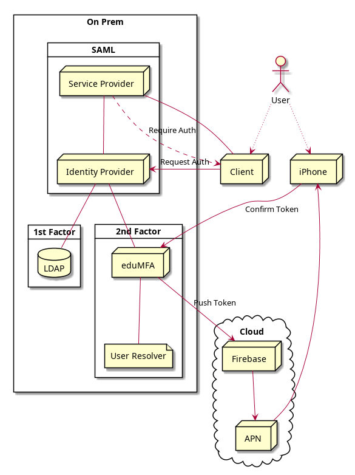

.. _edupush_token:

eduPUSH Token
----------

.. index:: eduPush Token, Firebase service

The eduPUSH token uses the *eduMFA Authenticator* app. You can get it
from `Google Play Store`_ or `Apple App Store`_.

.. _Google Play Store: https://play.google.com/store/apps/details?id=io.edumfa.authenticator
.. _Apple App Store: https://apps.apple.com/app/edumfa-authenticator/id6479982721

The token type *edupush* sends a cryptographic challenge via the
Google Firebase service to the smartphone of the user. This push
notification is displayed on the smartphone of the user with a text
that tells the user that he or somebody else requests to login to a
service. The user can simply accept this request.
The smartphone sends a cryptographically signed response to the
eduMFA server and the login request gets marked as confirmed
in the eduMFA server. The application checks for this mark and
logs the user in automatically. For an example of how the components in a
typical deployment of eduPUSH tokens interact reference the following diagram.

  *A typical eduPUSH token deployment*

To allow eduMFA to send push notifications, a Firebase service
needs to be configured. To do so see :ref:`firebase_provider`.

The eduPUSH token implements the :ref:`outofband mode <authentication_mode_outofband>`.

Configuration
~~~~~~~~~~~~~

The minimum necessary configuration is an ``enrollment`` policy
:ref:`policy_firebase_config`.

With the ``authentication`` policies :ref:`policy_push_text_on_mobile`
and :ref:`policy_push_title_on_mobile` you can define
the contents of the push notification.

If you want to use eduPUSH tokens with legacy applications that are not yet set up to be compatible with out-of-band
tokens, you can set the ``authentication`` policy :ref:`policy_push_wait`. Please note, that setting this policy can
interfere with other token types and will impact performance, as detailed in the documentation for ``edupush_wait``.

Enrollment
~~~~~~~~~~

The enrollment of the eduPUSH token happens in two steps.

Step 1
......

The user scans a QR code. This QR code contains the
basic information for the eduPUSH token and an enrollment URL. V2 QR codes
include ``enrollment_credential`` and send ``require_device_auth=true`` when
the policy requires device authentication.

The smartphone stores this data and creates a new key pair.

Step 2
......

The smartphone sends its Firebase ID, the public key of the keypair,
the serial number and an enrollment credential back to the
enrollment URL of the eduMFA server.

The server returns the token's public key. For V2 tokens, the rollout response
and each successful challenge poll also include a ``detail.token_update`` object,
even when a poll finds no pending challenges.

V2 POST operations
~~~~~~~~~~~~~~~~~~

Send ``operation`` and ``serial`` in the JSON request to ``POST /ttype/edupush``.
The operation selects the remaining fields.

* ``complete_enrollment`` requires ``enrollment_credential``, ``pubkey`` and
  ``fbtoken``. It returns the server public key and token updates.
* ``respond_to_challenge`` requires ``nonce`` and ``signature``. The optional
  boolean ``decline`` defaults to ``false``. Sign the array
  ``["respond_to_challenge", serial, nonce, decline]``.
* ``update_firebase_token`` requires ``new_fb_token``, ``timestamp`` and
  ``signature``. Sign the array
  ``["update_firebase_token", serial, new_fb_token, timestamp]``, using the
  exact ISO 8601 timestamp sent in the request.

Sign the UTF-8 bytes of the compact JSON array with the enrolled device key
and Base32-encode the signature. These three operations require a V2 token.
An unknown operation or invalid payload is rejected. POST requests
without ``operation`` continue to use the existing payload and signature
formats. GET polling uses the existing format.

Protocol upgrades
~~~~~~~~~~~~~~~~~

An authenticated poll advertises an eligible upgrade in
``detail.available_upgrade.target_version``. The supported path is V1 to V2
for active, enrolled eduPush tokens. A missing stored version counts as V1.
The app can start the upgrade even when challenge polling is disabled.

Send both operations to ``POST /ttype/edupush`` using the V2 signing format
above over verified HTTPS. Send ``target_version`` as a JSON integer.

* ``begin_upgrade`` requires ``serial``, ``target_version``, ``timestamp`` and
  ``signature``. Sign ``["begin_upgrade", serial, target_version, timestamp]``.
  The response contains ``detail.upgrade`` with ``target_version``, ``nonce``,
  ``expires_at`` (Unix seconds), and ``require_device_auth``. The offer is valid
  for five minutes. A repeated begin returns the same unexpired offer.
* ``confirm_upgrade`` requires ``serial``, ``target_version``, ``nonce``,
  ``require_device_auth`` and ``signature``. Sign
  ``["confirm_upgrade", serial, target_version, nonce, require_device_auth]``.
  Send the boolean after preparing the app for V2, and set it to ``true``
  after enabling device authentication if required. The upgraded token keeps
  its serial and enrolled device key.

Successful confirmation returns ``detail.push_version``. Repeating confirmation
before the offer expires returns the same result. A fresh signed begin also
returns ``detail.push_version`` if the token already uses the target version.

Device migration
~~~~~~~~~~~~~~~~

An active, enrolled V2 token can move to a new phone while keeping its serial
and server key. Both phones must be available. The new app generates and
persists a fresh private key in platform-protected storage before pairing.
The old phone continues to approve logins until the transfer completes.
Afterwards, only the new phone can approve logins for that serial.

Use the V2 signing format and send all parameters in the JSON body of
``POST /ttype/edupush`` over verified HTTPS. Every signed array starts with
``[operation, serial, registration_url, ...]``. Use the exact HTTPS
registration URL configured for the token owner's enrollment policy.
The URL is signing context. The server derives it from policy and clients
omit it from the JSON body.

* ``begin_migration`` takes a fresh ISO 8601 ``timestamp`` signed by the old
  phone. Append ``timestamp`` to the signed array. The offer in
  ``detail.migration`` contains ``nonce``, ``expires_at`` (Unix seconds),
  ``registration_url`` and ``require_device_auth``. The app shows a transfer
  QR containing the serial, URL, nonce and device authentication requirement.
  Offers last five minutes.
  Repeating the request while the offer is open returns the same nonce.
* ``pair_migration`` is signed by the new key. Append ``nonce``, ``pubkey``,
  ``fbtoken`` and the boolean ``device_auth`` in that order. Use the same public
  key encoding as enrollment. If the offer requires device authentication,
  the new app enables it before sending ``true``. The first valid device
  proposal is fixed for the offer. The response gives the new app the
  server's ``public_key`` and a six-digit ``pairing_code`` to display, including
  leading zeros. Retrying the same proposal returns the same code.
* ``migration_status`` appends ``nonce`` and a fresh ISO 8601 ``timestamp``.
  The old phone can obtain the state and, once paired, the
  ``candidate_id`` that identifies the proposed key and registration.
  The new key can query the paired state and can check for ``completed``
  for up to five minutes after the switch.
* ``confirm_migration`` is signed by the old key after the user enters the
  new phone's code and verifies with the device PIN or biometric. Append
  ``nonce``, ``candidate_id``, ``pairing_code`` and ``device_auth`` (a boolean
  that must be ``true``). For an incorrect code, the result value is
  ``false``, and five incorrect attempts cancel the offer. On success the
  server atomically replaces the device key and Firebase registration and
  deletes existing challenges for the serial. A client that loses the
  response can check the result with the new key.
* ``cancel_migration`` appends only ``nonce`` and is signed by the old key.
  Cancellation and expiry leave the enrolled device usable. Start again
  with a fresh signed timestamp to generate a new offer.

The app is responsible for performing local device authentication before
signing the confirmation. The server verifies the signed assertion and
device key signatures. Deployments can configure a post-event
``UserNotification`` handler for ``edupush_migration_completed`` to notify
the token owner using their existing contact information. A phone that
cannot sign a transfer uses the institution's :ref:`lost_token` process.

Authentication
~~~~~~~~~~~~~~

V2 push and polling challenges omit ``question``. Verify the server signature
using ``nonce|url|serial|title|sslverify``.
The push app supplies notification text locally. iOS receives a generic fallback
alert with ``mutable-content`` enabled.

Triggering the challenge
........................

The authentication request is triggered by an application
just the same like for any
challenge response tokens either with the PIN to the
endpoint ``/validate/check`` or via the endpoint
``/validate/triggerchallenge``.

eduMFA sends a cryptographic challenge with a signature to
the Firebase service.
The firebase service sends the notification to the smartphone,
which can verify the signature using the public key from enrollment step 2.

Accepting login
...............

The user can now accept the login by tapping on the push notification.
The smartphone sends the signed challenge back to the authentication URL
of the eduMFA server.
The eduMFA server verifies the response and marks this authentication
request as successfully answered.

In some cases the push notification does not reach the smartphone.
The smartphone can also poll for active challenges.

Login to application
....................

The application can check with the original transaction ID
with the eduMFA server, if the challenge has been successfully
answered and automatically login the user.

